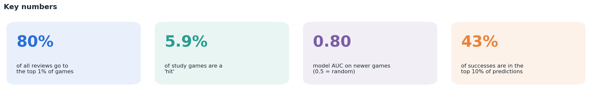
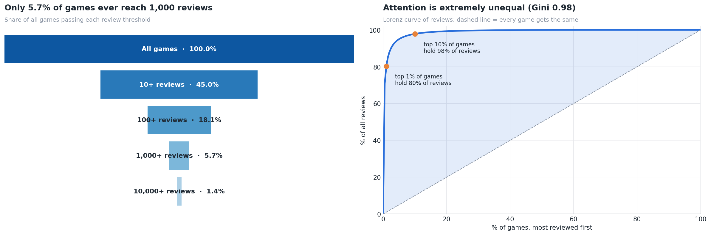
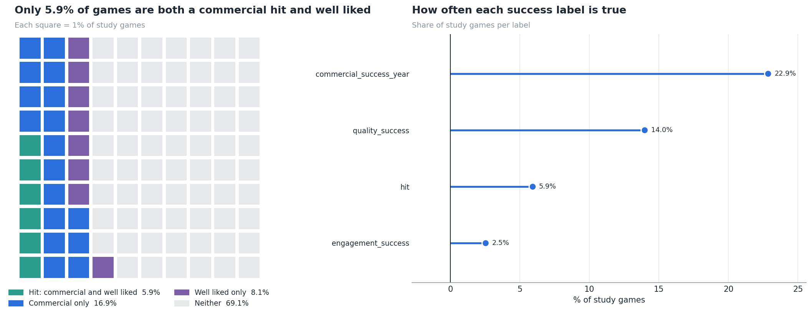
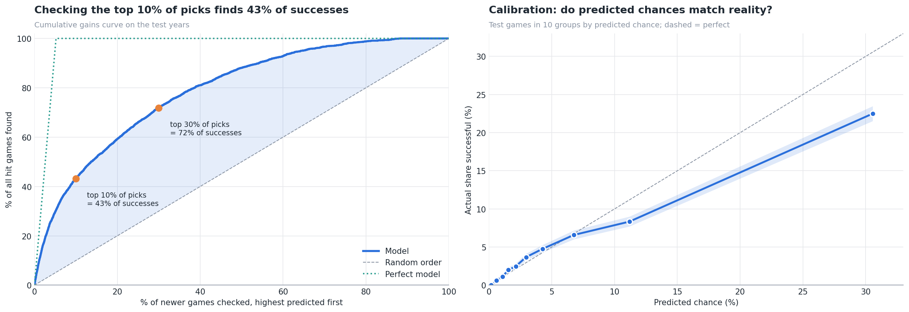
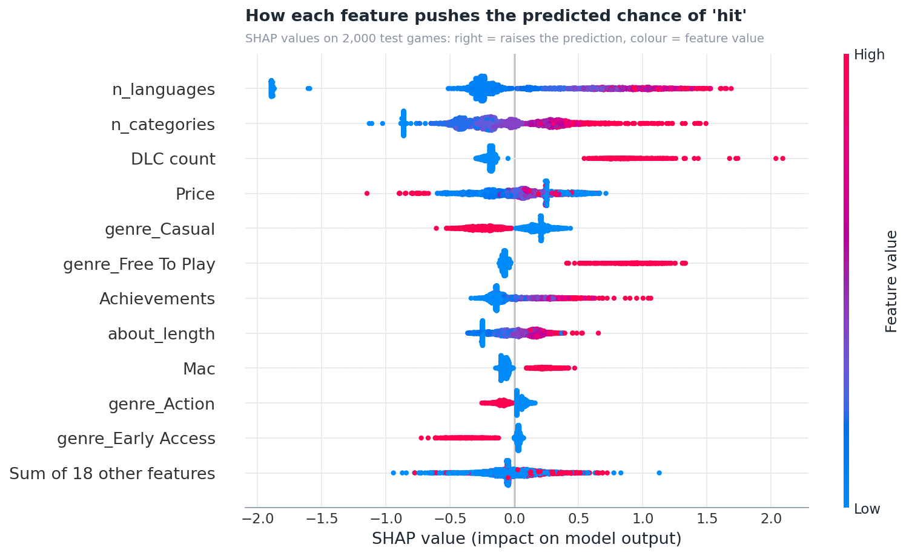

# 🎮 What makes a Steam game successful?

An end-to-end analysis of **125,855 Steam games**: defining success fairly, testing which launch-time features go with it, and predicting which new games become hits, using **Python, SQL (DuckDB) and machine learning**.

> Part of my data analytics portfolio. **Mihail Deligrozev**, data analyst (Python · SQL · Power BI)



---

## 📌 Key findings

| | Finding |
|---|---|
| 🏔️ | **Success is winner-takes-most.** The top 1% of games hold **80%** of all reviews and the top 10% hold **98%** (Gini 0.98). |
| ⚖️ | **Reach and quality are separate things.** Owners and positive-review share are uncorrelated (Spearman **0.00**), and only **26%** of commercial hits are also well liked. |
| 🎯 | **Consistent launch-time indicators.** More Steam categories, more languages, achievements, a higher price, a longer store description and DLC go with success under **all four** success definitions. |
| 🏷️ | **Genre matters.** RPG is the only genre above average under every definition (1.5x lift for `hit`); Violent is below average under every one. |
| 🤖 | **Launch facts predict success reasonably well.** For the strict `hit` label the model reaches **AUC 0.80** on newer games, and its top 10% of predictions contain **43%** of the actual hits. |
| 🧬 | **Track record counts.** A developer's history of earlier releases adds **+0.03 AUC**; store-page text adds +0.013. |
| 💾 | **Storage.** Lossless type optimisation cut the stored tables from **149 MB to 53 MB** in memory; as Parquet (zstd) they take **10 MB** on disk vs 40 MB as CSV. |

⚠️ These are **associations, not causes**: successful games can afford more languages and DLC, so some indicators follow success rather than drive it.

---

## 🔍 Approach

```
games.csv ──pandas──▶ cleaned data ──▶ DuckDB tables ──SQL──▶ aggregates ──Python──▶ statistics, models, charts
```

1. **Loading and cleaning:** fixed a broken CSV header (39 names for 40 columns, which shifted every column), dropped near-empty columns, removed duplicates, and parsed list-like text fields.
2. **Data model and storage:** stored the data as a small relational model in DuckDB (`games`, `game_genres`, `game_tags`, `labels`), shrank it with lossless type optimisation, and compared CSV, Parquet and DuckDB on size and read speed.
3. **Exploratory analysis:** release trends, a review ridgeline, a Lorenz curve of attention, and Spearman correlations between success metrics.
4. **Defining success:** four labels (commercial, quality, engagement and a strict `hit`). The commercial cutoff is set **within each release year**, because a single global cutoff mostly labels old games as successful.
5. **Testing indicators:** AUC as an effect size, success rates with Wilson 95% intervals, and genre/tag lift computed in SQL for all labels at once.
6. **Modelling:** gradient boosting with a **time-based split** (train ≤ 2021, test later) and launch-time features only, so there's no leakage from outcomes. Evaluated with AUC, cumulative gains and calibration, and explained with ablation, permutation importance and SHAP.
7. **Robustness:** every key result is rerun under all four success definitions, plus developer history (SQL window functions), TF-IDF store text, and an ordinal model of owner buckets.

| Model results on the test years | AUC | Precision vs random |
|---|---|---|
| `engagement_success` | 0.91 | 12.9x |
| `hit` | 0.80 | 4.5x |
| `quality_success` | 0.78 | 3.3x |
| `commercial_success_year` | 0.63 | 1.4x |

---

## 🖼️ Selected charts

| | |
|---|---|
|  |  |
|  |  |

All 26 charts are in [`figures/`](figures/).

---

## 🛠️ Tech stack

**Python:** pandas, NumPy, SciPy, scikit-learn, SHAP, matplotlib, seaborn
**SQL:** DuckDB with jupysql (`%%sql` cells): CTEs, joins, window functions (`ROW_NUMBER`, `NTILE`, `RANGE` frames)
**Storage:** Parquet (pyarrow), DuckDB
**Methods:** AUC / Mann-Whitney, Wilson intervals, lift, Spearman, Gini, gradient boosting, permutation importance, SHAP, TF-IDF, ordinal (cumulative-threshold) modelling

---

## 📁 Repository contents

| File | What it is |
|---|---|
| `steam-game-success.ipynb` | The full notebook, with code and outputs |
| `utils.py` | Plot style, chart helpers, statistics and parsing functions used by the notebook |
| `steam-game-success.html` / `.pdf` | Read-only report version with the code hidden |
| `figures/` | Every chart as a PNG |

---

## ▶️ How to run

**On Kaggle (easiest):**
1. Open the notebook on Kaggle and attach the [Steam Games Dataset](https://www.kaggle.com/datasets/fronkongames/steam-games-dataset) with **Add input**.
2. Attach `utils.py` as a model or dataset; the notebook finds the newest attached version automatically.
3. Turn **Internet** on (needed to install `duckdb` and `jupysql`) and choose **Save & Run All**.

**Locally:**
```bash
pip install pandas numpy scipy scikit-learn matplotlib seaborn shap pyarrow duckdb jupysql kagglehub
jupyter notebook steam-game-success.ipynb
```
Keep `utils.py` next to the notebook. The data downloads automatically with `kagglehub`, or you can place `games.csv` in the same folder.

---

## ⚠️ Limitations

- **Association, not cause:** the indicators describe successful games; they don't prove what makes a game successful.
- **Owners are estimated buckets,** so commercial success is approximate and ties at the cutoff are common.
- **Base-rate drift:** the share of successful games differs between training and test years, so rankings are reliable but raw probabilities need recalibrating.
- **Missing drivers:** marketing spend, wishlists, the quality of the game itself and luck aren't in the data.
- **Thresholds are choices** (top 10%, 50+ reviews, 80% positive); the notebook exposes them as parameters and checks that the conclusions hold across definitions.

---

**Data:** [Steam Games Dataset by Fronkon Games (Kaggle)](https://www.kaggle.com/datasets/fronkongames/steam-games-dataset)
